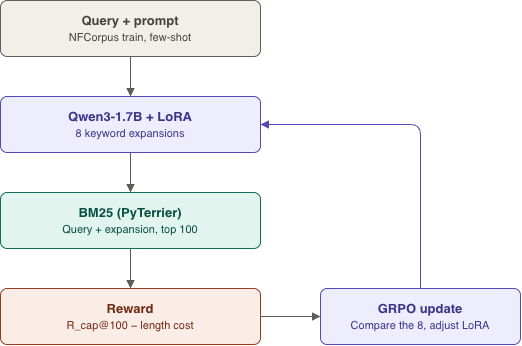
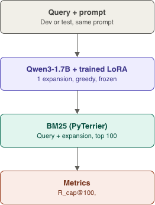
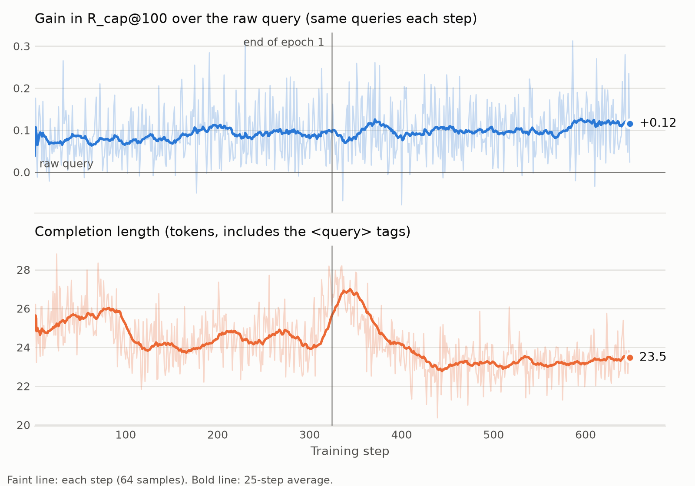

# GRPO query expansion for BM25

Train a small language model (Qwen3-1.7B + LoRA) with GRPO to expand search queries for a frozen BM25
retriever. The reward is **recall**: how many of the labelled relevant documents BM25 returns in its top 100.

## What we're doing

Given a query, the model writes a short list of extra keywords. BM25 searches with the original query plus
those keywords. During training the model is rewarded when more relevant documents appear in the top 100, so it
learns which keywords help retrieval. Only the language model is trained; BM25 stays fixed.

- **Training data:** NFCorpus train queries (2,590) with BEIR relevance labels.
- **Evaluation data:** NFCorpus test, plus SciFact and FiQA as transfer tests (no extra tuning).
- **Metric:** R_cap@100, the number of relevant documents in the top 100 divided by min(100, number of relevant documents).

## Architecture

**Training.** For each query, the model writes 8 expansions. Each is scored with BM25 and the reward, and GRPO
compares the 8 and updates the LoRA weights.



**Evaluation.** The trained model writes one expansion per query (greedy decoding, weights frozen), and BM25
searches with the query plus the expansion.



- **Prompt:** a fixed few-shot keyword prompt (instructions plus 3 worked examples), identical for training and
  evaluation (`train/prompts.py`). The model answers inside `<query>...</query>`.
- **Retriever:** BM25 from PyTerrier, using prebuilt indexes for NFCorpus, SciFact and FiQA (`retrieval/bm25.py`).
- **Search text:** the original query followed by the expansion.

## Reward

```
R = R_cap@100(query + expansion) - 0.001 * max(0, |expansion| - 26)    if the output is well formed
R = -0.1                                                               otherwise
```

`|expansion|` is counted in Qwen tokens. Well formed means exactly one `<query>...</query>` block
(`rewards/reward.py`, `configs/frozen.yaml`).

## Training details

| | |
|---|---|
| Base model | Qwen3-1.7B, thinking off |
| Adapter | LoRA, r = 32, alpha = 64, on q/k/v/o/gate/up/down (about 35M trainable parameters) |
| Algorithm | GRPO, `dr_grpo` loss, no KL term (beta = 0), no reward std scaling |
| Group size | 8 expansions per query |
| Batch | 8 queries per step = 64 completions per step |
| Sampling | temperature 1.0, up to 72 new tokens |
| Optimizer | AdamW 8-bit, learning rate 2e-5, 10% linear warmup then linear decay, weight decay 0.001 |
| Length | 648 steps (about 2 epochs over the 2,590 queries), seed 1 |
| Stack | Unsloth 2026.10.6, TRL 0.22.2, vLLM 0.15.1, transformers 4.57.6 |
| Hardware | one NVIDIA A30 (24 GB); about 45 minutes for the full run, about 12 GB peak GPU memory |

Training curves for the full run. Top: the gain in R_cap@100 over the raw query, measured on the same queries at each
step. It averages +0.076 over the first 108 steps and +0.110 over the last 108. About +0.08 of the early level is
the few-shot prompt before any training, so training adds roughly +0.03. Bottom: completion length, which stays
short. Each step's value is the mean over its 64 samples, so the faint line is noisy; the bold line is a 25-step
average.



## Results

R_cap@100 on the test sets, one training seed. "Few-shot" is the same model and prompt without training.

| Test set | Queries | Raw query | Few-shot (untrained) | Trained |
|---|---|---|---|---|
| NFCorpus | 323 | 0.262 | 0.343 | **0.367** |
| SciFact | 300 | 0.926 | 0.937 | 0.947 |
| FiQA | 648 | 0.559 | 0.530 | 0.534 |

## Reproduce

On a GPU machine with a JDK installed (PyTerrier needs one), inside a fresh virtual environment:

```bash
bash train/setup_jarvis.sh                       # installs the pinned training stack and checks it

python -m train.grpo --model unsloth/Qwen3-1.7B --max-steps 648 --save-steps 108 \
  --run-name q1.7b_rcap100_lr2e-5_G8_r1_s1_2ep --micro-batch 16 --gpu-memory 0.4

python -m train.eval_ckpt --run q1.7b_rcap100_lr2e-5_G8_r1_s1_2ep --adapter final_lora --split test
# transfer: add --dataset scifact (or fiqa) --split test; use --adapter none for the untrained model
```

Training and evaluation need a GPU; do not run them on a laptop.

## Repository layout

- `retrieval/`: BM25 retriever (PyTerrier) and Java setup
- `rewards/`: the GRPO reward
- `train/`: prompt, GRPO training script, checkpoint evaluation, GPU setup script
- `eval/`: metrics and scoring of expansions
- `data/`: BEIR loading through ir_datasets
- `configs/`: frozen settings (prompt, length limit, reward, sampling)
- `results/`: result files; `diagrams/`: the figures above
